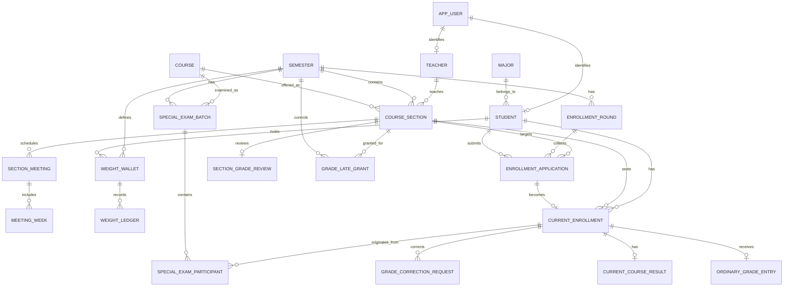

# 学生选课与成绩管理系统｜数据库设计（第一版完整详尽草案）

> **建议项目路径**：`docs/数据库设计.md`  
> **版本**：V1.0 / 阶段 0 数据库设计草案  
> **整理日期**：2026-11-20  
> **依据**：`docs/需求与业务规则.md`、`docs/变更记录.md`（CHG-001～CHG-072）、`docs/项目总计划书.md`  
> **技术方向**：MySQL 8.x / InnoDB / Java 21 / Spring Boot / MyBatis-Plus + MyBatis XML  
> **状态**：**候选数据模型，尚未完成 ER 审核、DDL 编写和真实数据库验证；不可标记为已经实施。**

## 0. 阅读说明和设计边界

本文件是**可直接使用的第一版数据库设计草案**，不是随手列出的表名清单，也不是已在 MySQL 中执行成功的建表脚本。它说明哪些业务事实需要保存、为什么拆分这些事实、实体关系如何连接、关键约束和事务如何验证。

**规范用语：**

- **【已确认需求】**：来自最终《需求与业务规则.md》，设计不能擅自改变。
- **【设计建议】**：本文件为满足需求提出的一种可实现方案；字段、索引、拆表形式还需由你审查并在真实 MySQL 中验证。
- **【待技术定稿】**：业务规则基本确认，但尚需明确存储精度、时间边界、锁定策略、查询语义等设计选择。不得把它说成用户已确认的业务要求。
- **【后续版本】**：不属于第一版必做，例如重修、先修课程、复杂排课、AI/Redis。

### 0.1 设计目标

1. 支持学生、教师、管理员和学籍管理，保持身份与业务主体分离。
2. 支持课程目录、专业/年级限制、学期、教学班和任意教学周集合的排课。
3. 支持**报名即时扣权重 → 本轮截止 → 按权重排序录取 → 同权重随机 → 开班确认/待开班/最终取消 → 两轮补选 → 退课与权重清零**。
4. 支持普通课程成绩录入、72 小时审核、到期整班自动生效、普通截止与迟交授权。
5. 支持已发布成绩的精准更正授权、执行即生效、申请撤回及到期失效。
6. 支持同学期同课程**唯一特殊考试批次**、名单冻结、多负责人、72 小时审核与按资格计算不同最终成绩。
7. 支持当前正式成绩、班级平均分、累计 GPA 与同一入学年级的 `RANK()` 排名。
8. 保存必要历史；关键事务可以回滚、幂等、并发验证；不通过删除历史来修正数据。

### 0.2 旧版八张表为什么不足

旧模型主要是 `student / teacher / course / semester / course_section / section_schedule / enrollment / app_user`，适合简单先到先得选课。现在至少需要辨别：**报名与录取、权重余额与流水、课程是否已开班、成绩草稿与正式结果、原始成绩与特殊考试结果、普通迟交与已发布更正授权**。

因此本文件建议按业务领域拆分实体，不预先承诺“最终一定是 N 张表”。一张表是否独立，以**独立生命周期、历史追溯、唯一性或事务一致性**作为判断依据。不要为了表数少把不相干状态塞进 `enrollment`；也不要为了表多而为每个枚举造一张表。

### 0.3 阶段 0 数据库设计的完成定义

- [ ] 你能够解释本文件中每个核心实体的身份、关系与用途。
- [ ] ER 图已画出主要关系，并标明必要基数和可选关系。
- [ ] 核心字段类型、NULL 语义、唯一约束、外键及历史保留策略已核对。
- [ ] 关键状态变化、事务边界及并发控制已经有可验证方案。
- [ ] 写出 `database/schema.sql` 和 `database/seed.sql`，并在独立测试库执行通过。
- [ ] 用真实 SQL 验证至少：重复报名、余额不足、正偶数容量、教师冲突、普通成绩与特殊成绩关联。
- [ ] 设计文档与 DDL 一致，并保留设计取舍和验证结果。

---

## 1. 全局设计约定

### 1.1 命名与物理类型（候选约定）

| 类型 | 候选约定 | 使用原因或注意点 |
|---|---|---|
| 主键 | `id BIGINT`，统一生成策略 | 业务主键与学号/课程代码等自然键分离 |
| 外键 | `<entity>_id BIGINT` | 引用清晰；可结合实际性能选择数据库外键策略 |
| 业务编号 | `VARCHAR(...)` + 唯一约束 | 学号、工号、课程代码、学期代码应分别唯一 |
| 状态 | `VARCHAR(20~40)` 或受控小整数 | 值域必须在服务层和数据库设计中保持统一 |
| 时间点 | `DATETIME(6)`（建议统一存 UTC） | 业务判断转换为学校时区；不能混用 JVM/DB 本地默认时区 |
| 日期 | `DATE` | 学期首日、日期型成绩截止等 |
| 教学周 | `TINYINT` 或 `SMALLINT` | 合法周号 1～20，授课通常 1～18 周 |
| 节次 | `SMALLINT` | 使用半开区间 `[start_slot,end_slot)` |
| 权重点 | 候选 `INT` | **是否只允许整数待技术定稿**；不能未经确认写死用户可以投小数 |
| 分数 | 候选 `DECIMAL(5,2)` | 可避免二进制浮点比较误差；最终允许的小数位待核对 |
| 学分 | 候选 `DECIMAL(5,2)` | 可适应非整数学分，学分一旦开班使用后冻结 |
| GPA | 由定点成绩/学分按足够精度计算 | 不因显示的两位小数相同而人为并列 |
| 可空字段 | 仅在业务确有“尚无值”时允许 | `NULL` 不能随意代表 0、缺考或缓考 |
| 审计时间 | `created_at`、`updated_at`、关键事件时间 | 不是所有历史都能靠一列 `updated_at` 追溯 |

**建议**：若用 `DATETIME(6)` 存 UTC，Java 侧需把时钟、时区转换和数据库连接参数统一。可以选其他可靠方案，但必须把“存储时区”和“学校业务时区”写清，并用跨日、跨年的测试验证。

### 1.2 身份键与自然键

- 学生：数据库 `student.id` 与唯一学号 `student_no` 分开。
- 教师：数据库 `teacher.id` 与唯一工号 `teacher_no` 分开。
- 课程：数据库 `course.id` 与唯一课程编号 `course_code` 分开。
- 学期：数据库 `semester.id` 与唯一学期编号 `semester_code` 分开。
- 教学班：数据库 `course_section.id` 与该学期内可读 `section_code` 分开。
- 一切成绩、报名和历史原则上引用**不会因改名而改变的数据库 ID**，而非引用展示名称。

### 1.3 数据删除原则

1. 课程停用是业务状态变化，不删除正在运行的班级、历史选课与成绩。
2. 学生休学、退学、毕业不删除个人历史成绩。
3. 报名撤回/落选保留申请与结算历史，不通过删除记录冒充从未报名。
4. 正式退课后，**当前有效选课关系可以物理删除**，但操作事实、原申请、权重流水和必要审计必须保留；不得删除已生效成绩。
5. 已发布成绩的旧值不能被不留痕迹地覆盖；所有更正需可追溯。
6. 特殊考试的原始成绩与最终认定分数分开保存。

### 1.4 统计值与事实值

优先持久化不能从其他事实可靠还原的**原始业务事实**，再通过查询计算统计。可以按性能需要保存 `enrolled_count`、当前 GPA 缓存等派生值，但必须有一致性维护方案。

**不变量示例：**若在 `course_section` 保存 `enrolled_count`，应保证它与当前有效占位记录数量一致；若保存权重 `available_points`，应能通过权重事件/流水解释每次变化。不能“前端显示对了”就认为数据库正确。

---

## 2. 概念 ER 与业务领域

### 2.1 主关系图（概念层，不代表已定稿表数）



**阅读说明：**概念图省略了权限、范围关联、教师更换、成绩更正审批和权重历史等部分边，以免图难以阅读；这些实体在下文详细说明。`ENROLLMENT_APPLICATION` 到 `CURRENT_ENROLLMENT` 的“0 或 1”关系表示一次报名最多产生一个当前有效名额，而不是所有报名都录取。已退课的原报名可保留，但当前有效关系不存在。

### 2.2 概念实体分组

| 领域 | 核心实体或事实 | 是否建议独立保存 |
|---|---|---|
| 组织与身份 | 专业、学生、教师、账号、学籍事件 | 建议；学籍事件用于追溯 |
| 课程目录 | 课程、课程专业限制、课程入学年级限制 | 建议独立或明确配置结构 |
| 学期与排课 | 学期、教学班、上课片段、教学周集合 | 建议独立 |
| 轮次与报名 | 选课轮次、报名申请、轮次结算、当前有效选课 | **必须在逻辑上区分** |
| 权重 | 学生学期权重账户、权重变更流水 | **必须在逻辑上区分** |
| 课务历史 | 退课/取消历史、容量变更、教师变更 | 可采用统一事件模型 |
| 普通成绩 | 成绩录入、班级审核、当前正式成绩 | **必须在逻辑上区分草稿和已生效** |
| 截止与更正 | 学期截止变更、班级迟交授权、成绩更正申请、成绩版本历史 | 建议独立 |
| 特殊考试 | 批次、负责人、名单/成绩、批次审核 | 必须可区分并审计 |
| 统计与权限 | GPA/排名查询、教师统计权限、操作审计 | GPA/排名可查询计算，不必立即建缓存表 |

### 2.3 核心关系与基数

1. 一个学生属于一个当前专业、一个入学年级，并拥有一个学籍状态；一个专业可以有多名学生。
2. 一个课程可以在多个学期有多个教学班，一个教学班只属于一门课程和一个学期。
3. 一个教学班可有多个上课片段，每个片段可有多条教学周编号。
4. 一个学期恰有三种选课轮次：正常选课、第一轮补选、第二轮补选（每类型至多一条）。
5. 一个学生在一个学期至多有一个有效权重账户；账户可产生多条权重流水。
6. 一条报名只属于某一轮、某一学生、某一个教学班；一条报名最多导出一个当前有效选课名额。
7. 一个学生同学期同课程至多存在一个当前有效目标；历史失败/退课申请可以多条，但不得同时处于有效报名状态。
8. 一个教学班有一个普通成绩审核生命周期；每条合法有效选课有对应的普通成绩录入状态和当前正式结果（尚未发布时后者可不存在）。
9. 同学期同课程至多存在一个特殊考试批次；批次可覆盖多个原教学班的学生，所有结果回归各自原选课。
10. 一个学生的某门课可以有多次被授权更正的历史，但同一时间至多一条活动更正申请。

---

## 3. 学籍、人员与登录账号

### 3.1 `major`｜专业目录【设计建议】

| 候选字段 | 作用 | 约束或说明 |
|---|---|---|
| `id` | 主键 | 非空、唯一 |
| `major_code` | 专业编号 | 非空、唯一、稳定 |
| `major_name` | 专业名称 | 非空 |
| `status` | 可用/停用 | 停用不删除历史学生与课程关系 |
| `created_at`、`updated_at` | 维护时间 | 审计基础 |

**为什么单独建专业表**：课程可以限制多个专业，学生也需要稳定的专业标识；不应在课程字段中存储“计算机,软件,人工智能”逗号分隔字符串。

### 3.2 `student`｜学生

| 候选字段 | 作用 | 约束或说明 |
|---|---|---|
| `id` | 学生内部 ID | 主键 |
| `student_no` | 学号 | 唯一 |
| `name` | 学生姓名 | 非空 |
| `major_id` | 当前专业 | 外键或受控引用 `major.id` |
| `entry_year` | 入学年级 | 用于同年级 GPA 排名；不可与当前年级年数混淆 |
| `enrollment_status` | 学籍状态 | `NORMAL / SUSPENDED / WITHDRAWN / GRADUATED` 等候选代码 |
| `created_at`、`updated_at` | 时间 | 记录维护 |

- **【已确认需求】**只有正常在读可以正常报名/选退课；非在读仍可登录查本人历史正式成绩。
- **【设计建议】**当前 `enrollment_status` 提供高效业务校验；另存状态变更事件以便审计。
- **【待技术定稿】**是否允许学生转专业、入学年级变更，以及已报名时改状态的处理顺序，不能默认为普通学生可以自行编辑。

### 3.3 `student_status_event`｜学籍状态事件【设计建议】

字段示例：`id, student_id, old_status, new_status, reason, operator_user_id, changed_at`。

用途：记录休学、复学、退学、毕业等状态变化；**事件历史**与 `student` 的**当前状态**互补，不用通过覆盖一个状态字段就丢失过去。

### 3.4 `teacher`｜教师

字段示例：`id, teacher_no, name, status, created_at, updated_at`。

- 工号唯一；可按教学班查询其授课任务。
- 教师不能因拥有教师角色而访问别人的成绩。
- 教师被调离某教学班后，新教师需要通过排课冲突校验，历史教师归属变化应可查询。

### 3.5 `app_user`｜登录身份

字段示例：`id, username, password_hash, role, student_id, teacher_id, account_status, created_at, updated_at`。

建议约束：

- `username` 唯一；密码保存强散列，**绝不保存明文密码**。
- 登录主体可以是学生、教师或管理员；账户与业务主体的一对一或可选关系必须一致。
- 不允许一条账户任意冒用不存在的学生或教师。
- `role` 限定基本角色；特殊考试的“批次负责教师”权限**不应**靠提升为全局管理员实现。

**待技术定稿**：管理员是否独立业务表、一个自然人能否有多个身份，以及采用单角色字段还是角色关联表。首版可采用最小可靠方案，不必为未来复杂权限体系过度设计。

---

## 4. 课程目录、选课限制、学期与排课

### 4.1 `course`｜课程目录

候选字段：`id, course_code, course_name, credits, status, used_for_section, created_at, updated_at`。

- 课程代码唯一；学分为正的定点数。
- **【已确认需求】**课程曾经用于创建过教学班后，普通操作不可改学分，即使教学班后来取消也不能通过删除历史绕过冻结。
- `used_for_section` 是**候选加速字段**，也可通过永久保留的使用事件判断；不能仅根据当前是否还存在教学班做冻结判断。
- `status` 的停用不删除现存教学班和历史成绩；停用后不得创建后续新教学班。

### 4.2 课程允许专业和入学年级的规则【设计建议】

候选结构：

- `course.allowed_all_majors`：是否不限专业。
- `course_allowed_major(course_id, major_id)`：限制专业时允许的专业列表。
- `course.allowed_all_entry_years`：是否不限入学年级。
- `course_allowed_entry_year(course_id, entry_year)`：限制入学年级时允许的年份。

**关键 NULL/空集合问题**：没有任何关联记录究竟表示“不限制”还是“禁止所有人”？必须显式区分；推荐用布尔型“是否不限”字段，避免误判。

专业和入学年级的限制是两项独立检查；两个都配置限制时必须**同时**满足。学生提交报名时服务端检查，不能仅在列表展示时过滤。

### 4.3 `semester`｜学期

| 候选字段 | 作用 | 约束或说明 |
|---|---|---|
| `id`、`semester_code`、`name` | 学期身份 | 学期代码唯一 |
| `week1_monday` | 第一周星期一 | 必须确实为星期一 |
| `grade_entry_deadline_date` | 普通成绩截止日 | 默认第 20 周周日后 14 天；范围为该周日至其后 30 天 |
| `school_timezone` | 业务时区引用 | 可采用全校配置，不必每学期重复存储 |
| `created_at`、`updated_at` | 维护时间 | 时间合法性和操作审计 |

- 学期始终为 20 周，第 1～18 周教学，第 19～20 周考试。学期结束日可由首日 `+ 20*7-1` 天计算。
- `PLANNED / IN_PROGRESS / FINISHED` **按当前学校日期计算**，不必将可由日期推导的状态作为管理员可编辑字段。
- 一旦**曾创建**任何教学班，学期首日不可再编辑。建议保留不可逆的使用标记或创建事件，不要因为取消教学班而解除限制。
- 成绩截止与选课截止不是同一个时间概念，不要共用一个 `deadline` 字段。

### 4.4 `enrollment_round`｜选课轮次

| 候选字段 | 作用 | 约束或说明 |
|---|---|---|
| `id` | 本轮 ID | 主键 |
| `semester_id` | 所属学期 | 外键 |
| `round_type` | 正常选课 / 第一轮补选 / 第二轮补选 | `NORMAL / SUPPLEMENT_1 / SUPPLEMENT_2` 候选 |
| `start_at`、`end_at` | 窗口起止 | 正常选课 3 天、补选 2 天和 1 天 |
| `settlement_status` | 尚未结算/结算中/已完成 | 具体状态机待技术定稿 |
| `settled_at` | 结算完成时间 | 幂等、清零顺序依据 |

建议唯一约束：`UNIQUE(semester_id, round_type)`；同一学期不得出现两个“第一次补选”。

- 正常轮次开始于第 1 周星期一前 14 天。
- 各轮是否连续、不同时段的具体小时数仍属**待技术定稿**，但每轮持续的自然日天数是已确认需求。
- 报名以轮次时间窗口为准，不因为学期此时 `PLANNED` 就错误禁止开学前报名。
- 轮次截止与结算成功是两个不同时间点；不能仅靠一个 `end_at` 代表结果已经确定。

### 4.5 `course_section`｜实际开课班级

| 候选字段 | 作用 | 约束或说明 |
|---|---|---|
| `id`、`section_code` | 教学班身份 | 建议同学期编号唯一 |
| `semester_id`、`course_id` | 所属学期与课程 | 必须合法 |
| `teacher_id` | 当前授课教师 | 老师历史另存事件 |
| `capacity` | 最大容量 | **正偶数**，是硬上限 |
| `enrolled_count` | 当前有效占位数（候选） | 若冗余保存，必须和真实有效名额同步 |
| `schedule_release_status` | 是否已对外开放课表 | 课表冻结边界，不等于开班人数状态 |
| `opening_status` | 待开班 / 已确认开班 / 最终取消 | 与报名开放状态分离 |
| `opening_confirmed_at` | 首次确认开班时刻 | 决定确认后不因正常退课退回 |
| `canceled_at`、`cancel_reason` | 最终取消信息 | 保留历史 |
| `created_at`、`updated_at` | 时间 | 一致性维护 |

**为什么建议拆成两个状态维度？**“课表是否已开放”和“是否达到最低开班人数”不是同一件事。不能用 `OPEN` 同时代表可报名、人数已达标、课程正在授课，否则会形成难以判断的状态组合。

关键约束：

- `capacity > 0 AND MOD(capacity,2)=0`（候选数据库 CHECK + 服务端校验）。
- `0 <= enrolled_count <= capacity`（如保存该计数）。
- 最低开班人数**推导为 `capacity / 2`**，不需要同时存一个可能过期的 `min_enrollment` 字段。
- `opening_status=CONFIRMED` 后不能因合法退课自动退回 `PENDING`。
- 待开班班级可进入后续轮次接受申请；最终仍不足则取消并返还。
- 确认开班后再修改容量也要遵守正偶数和不低于人数等条件；确认状态不得因普通退课恢复待开班。

### 4.6 `section_meeting` 与 `meeting_week`｜课表及不连续教学周

候选：

```text
section_meeting
  id, section_id, day_of_week, start_slot, end_slot

meeting_week
  meeting_id, week_no
  主键可考虑 (meeting_id, week_no)
```

例如第 `{1,3,5,7}` 周周三 `[3,5)` 上课，`section_meeting` 保存一次星期与节次，`meeting_week` 保存四条教学周。

时间冲突条件需要同时满足：

1. 两条安排存在相同的 `week_no`；
2. `day_of_week` 相同；
3. 节次满足 `old.start_slot < new.end_slot AND new.start_slot < old.end_slot`。

允许时间区间边界相接，不应把 `[1,3)` 与 `[3,5)` 判为冲突。

**教学班自身时间片段也不能非法重复冲突**。第一版不支持不同 Section ID 通过“合班”名义共用同一授课时段绕过同一教师冲突。

### 4.7 `section_change_event`｜教师、容量及开班历史【设计建议】

候选字段：`id, section_id, event_type, old_value, new_value, reason, operator_user_id, occurred_at`。

用途：记录教师替换、容量调整、开班确认、最终取消等关键变化。对容量调整操作，需要保留改前、改后值及理由；对教师变更，保存原教师、新教师。

**注意**：审计事件不替代主表的当前值；主表读当前状态，事件表追溯为什么变了。

---

## 5. 权重余额、申请、录取与退课（核心）

### 5.1 为什么至少分成四类业务事实

| 事实 | 要回答的问题 | 不能替代的内容 |
|---|---|---|
| 权重账户 | 学生现在还剩多少可用点数？ | 无法说明哪一笔报名扣了多少 |
| 权重流水 | 某次扣除、返还、发放、清零为何发生？ | 不能单独代表报名是否成功 |
| 报名申请 | 学生对哪个班、在哪轮投入多少点，最终竞争结果如何？ | 不能直接代表当前有效课表 |
| 当前有效名额 | 学生现在是否占有该班名额、班级是否开班？ | 不保留撤回、落选和退课的全部历史 |

### 5.2 `weight_wallet`｜学生—学期权重账户

| 候选字段 | 作用 | 约束或说明 |
|---|---|---|
| `id` | 账户 ID | 主键 |
| `student_id`、`semester_id` | 学生与学期 | `UNIQUE(student_id, semester_id)` |
| `available_points` | 学生当前可见余额 | 不得为负 |
| `wallet_status` | 尚未发放 / 有效 / 已清零失效 | 仅作为技术状态候选 |
| `initial_granted_at` | 首次 100 点发放时间 | 防止重复发放 |
| `supplement_granted_at` | 第一轮额外 50 点发放时间 | 防止重复发放 |
| `cleared_at` | 最终清零时间 | 清零后退课不再恢复可用余额 |
| `version`、`updated_at` | 并发保护及维护时间 | 版本号只是候选，不代替正确事务 |

**核心逻辑**：`available_points` 是当前可花费余额；学生提交申请立即减小，批准录取**不再扣第二次**。退课在权重有效期内才恢复；最终清零后合法退课只改变名额。

**待技术定稿**：权重点数是否仅允许非负整数；每次申请投入是否至少 1 点；不应在未确定前强加不必要的扣款粒度。

### 5.3 `weight_ledger`｜权重流水

候选字段：

| 字段 | 作用 |
|---|---|
| `id` | 流水主键 |
| `wallet_id` | 对应学生学期账户 |
| `event_type` | `INITIAL_GRANT / SUPPLEMENT_GRANT / APPLICATION_DEBIT / WITHDRAW_REFUND / LOSS_REFUND / CANCELLATION_REFUND / DROP_REFUND / FINAL_CLEAR` 等候选 |
| `points_delta` | 本次余额变化，正数增加、负数减少 |
| `application_id`、`enrollment_id` | 对应业务来源（根据事件类型可空） |
| `idempotency_key` | 本次业务事件防重复标识（候选） |
| `balance_after` | 变更后余额（候选，便于核账） |
| `occurred_at` | 实际生效时间 |
| `operator_type`、`operator_id` | 学生操作/系统自动/管理员等来源 |

重点：

- **单次报名扣除**必须关联到该申请，不能仅有一条“学生减 40 点”的无来源记录。
- **每笔返还**必须能追溯到原先扣除的申请，不能返还别人的投入。
- 每个业务事件应有可实现的唯一幂等约束；是否采用独立 `idempotency_key`、业务唯一键或两者结合，实施前定稿。
- 初始发放与补选发放分别防重复；同一学期不因重启服务再次领取 100/50。
- 最终清零可以记录为将当时余额扣至 0 的负向流水；清零后仍保留原历史。

**示例余额核对（已确认业务）**：初始 100；报名 A 40、报名 B 30 后余额 30；B 落选返 30 后余额 60；第一轮补选全员加 50 后余额 110。**录取 A 不再额外扣 40**，因为报名时已扣。实际账本必须支持重试核账。

### 5.4 `enrollment_application`｜分轮报名申请

| 候选字段 | 作用 | 约束或说明 |
|---|---|---|
| `id` | 申请唯一 ID | 主键 |
| `student_id` | 报名学生 | 外键 |
| `section_id` | 目标教学班 | 外键 |
| `round_id` | 所属正常轮/第一补选/第二补选 | 外键 |
| `semester_id`、`course_id` | 查询与并发校验辅助字段（可选冗余） | 如存储必须与目标教学班一致 |
| `bid_points` | 本次投入权重 | 合法范围待核对 |
| `status` | 有效报名、已撤回、落选、获名额等 | 状态迁移必须受控 |
| `submitted_at`、`withdrawn_at`、`settled_at` | 关键时间 | 保留历史 |
| `settlement_id` | 所属结算记录 | 结算前可空 |
| `tie_break_value` | 同权重抽签结果（可选） | 应可审计并在重跑时稳定 |

- 报名成功提交和账户扣除必须在**同一个数据库事务**中完成。
- 当前有同学期同课程另一活动报名/名额，拒绝再报名；已撤回、落选、合法退课后按规则允许重新报名。
- 学生提交第二个与现有活动目标**教学周+星期+节次实际冲突**的报名，立即拒绝且余额不变。
- **申请状态并不等于开班状态**：获名额的申请可能对应待开班班级；不能在成绩模块把“报名成功”的人当作已选课程学生。
- 对每个申请只能结算一次；申请同轮可重复操作的具体规则须通过状态和约束控制。

### 5.5 `round_settlement`｜选课轮次结算【设计建议】

候选字段：`id, round_id, section_id, status, started_at, completed_at, candidate_count, seat_count_before, seats_awarded, random_seed_reference, error_info`。

**建议**：以**轮次 × 教学班**作为单次结算对象，并有唯一业务键 `UNIQUE(round_id, section_id)`；能够重试但不能产生第二份改变结果的结算。

结算按本班该轮**尚可用名额**处理，不重排早期轮次已获得的名额。

同权重随机必须可追溯。建议在事务中一次性确定并保存排序/抽签相关事实；若失败回滚，则重试依据一致策略重新执行；若事务已经提交，再重复调用必须读到旧结果而不是重新抽签。

### 5.6 `current_enrollment`｜当前有效选课名额

| 候选字段 | 作用 | 约束或说明 |
|---|---|---|
| `id` | 名额关系 ID | 主键 |
| `student_id`、`section_id` | 学生与教学班 | 引用已有主体 |
| `semester_id`、`course_id` | 可选冗余业务维度 | 必须与 `section_id` 指向的学期/课程一致 |
| `source_application_id` | 从哪次报名获得名额 | 唯一引用申请（建议） |
| `seat_status` | `PENDING_OPENING / CONFIRMED`（候选） | 区分待开班名额与可正常上课名额 |
| `accepted_at` | 获得名额时间 | 轮次结算时确定 |
| `opening_confirmed_at` | 对应班级确认开班时间（可不冗余） | 别把学生录取和班级开班混为一谈 |

**退课方案与原需求的关系**：现行有效名额在合法退课时可以从本表删除；但 `enrollment_application` 仍保留获名额事实，`enrollment_event` 记录退课动作，权重流水记明返还与否。这兼容“当前有效关系物理删除，历史另行保存”的要求。

**关键唯一性**：

- 至少 `UNIQUE(student_id, section_id)`：同一个学生不能重复占同班名额。
- **同一学生 × 学期 × 课程同时至多一条有效名额**；如果保留冗余 `semester_id/course_id`，可考虑 `UNIQUE(student_id, semester_id, course_id)`，但必须证明冗余维度与目标班级一致。
- 活动报名与有效名额**合起来**也不能绕过同课程唯一/时间冲突；仅给本表加唯一索引不足以防申请阶段冲突，应在锁协议中统一校验。
- 跨不同学期不可设置“学生＋课程终身唯一”，以免阻止未来重修扩展。

### 5.7 `enrollment_event`｜撤回、落选、退课与取消历史【设计建议】

候选字段：`id, student_id, section_id, application_id, enrollment_id, event_type, reason, actor_user_id, occurred_at, related_ledger_id`。

- 报名撤回、落选、获得名额、待开班转确认、主动退课、最终不开班撤销应可追溯。
- 如果名额物理删除，不能仅依赖名额外键保存历史：**审计需要保留原名额 ID/快照或允许历史引用已删除对象**；真正的数据库外键策略必须据此设计。
- 已确认开班后正常退课跌破最低人数，不触发再次自动取消；退课只释放名额和相应容量。

### 5.8 权重与名额的完整状态变化

```text
报名提交
  ├─ 校验失败 → 不创建有效申请、不扣权重
  └─ 校验成功 → 创建有效报名 + 可用余额立即扣除
                        │
                 本轮截止，等待结算
                        │
            ┌───────────┴───────────┐
          落选                     获得名额
            │                         │
      返还本次投入                ┌─────┴─────┐
                               班级已开    班级待开
                                  │          │
                               有效名额   等待后续轮次
                                             │
                                    ┌────────┴─────────┐
                                 达最低人数        最终仍不足
                                    │                   │
                                确认开班       撤销名额+应返还权重
```

本轮截止前撤回走另一条路径：撤回申请＋返还该笔权重。不允许撤回动作在已正式结算申请上无条件重复执行。

### 5.9 清零与退课的时间边界

- 清零操作必须发生在**第二次补选全部结算、落选返还及最终不开班返还处理完成之后**。
- 清零前合法退课：删除当前有效名额、记录事件、释放容量、返还投入。
- 清零后合法退课：删除当前有效名额、记录事件、释放容量，**不增加可用余额**。
- 清零之后发生的其他历史调整不能“重新激活选课可用额度”；必要时保留审计事实而不修改已经失效的余额。
- 提醒：清零并不等于学期退课窗口结束，二者是独立业务概念。

---

## 6. 普通成绩、审核发布和截止管理（核心）

### 6.1 为什么要分成草稿结果与当前正式结果

| 数据概念 | 什么时候存在 | 学生能否查看 |
|---|---|---|
| 普通成绩草稿 | 教师尚在录入、修改或 72 小时审核期内 | 不可查看未正式生效的结果 |
| 正常班级审核状态 | 第一次全员结果录齐时开始 72 小时 | 学生不查看内部工作状态 |
| 当前正式课程结果 | 审核完成并统一生效后存在 | 学生只看本人这一份有效结果 |
| 原始/历史结果 | 后续补考、更正后的之前版本 | 学生普通页面不显示，授权后台审计可查 |

### 6.2 `ordinary_grade_entry`｜原班级成绩草稿与最初事实

| 候选字段 | 作用 | 约束或说明 |
|---|---|---|
| `id` | 录入记录 ID | 主键 |
| `enrollment_id` | 对应当前课程名额 | 一名学生某班唯一 |
| `entry_type` | `UNENTERED / NUMERIC / ABSENT / DEFERRED` 等 | 不得以数值 0 表示缺考或未录入 |
| `raw_score` | 原始考试数值（如适用） | 仅 `NUMERIC` 时取值；范围 0～100 |
| `absence_approved` | 缺考是否批准 | 适用时记录；不应在缓考/正常成绩上乱填 |
| `recorded_by`、`recorded_at` | 教师与首次录入时间 | 为录齐和截止判断提供证据 |
| `updated_at` | 最近修改时间 | 审核期内修改不重置开始时间 |

**无批准缺考的注意点**：原始事实仍为“缺考且未获批准”，当正常班级正式发布时课程**有效数值成绩为 0**；不能因为最终是 0 就丢失“曾经缺考”的事实。

### 6.3 `section_grade_review`｜普通班级 72 小时审核

候选字段：`id, section_id, review_status, first_completed_at, review_end_at, published_at, published_version`。

- 建议 `UNIQUE(section_id)`，一个教学班一个普通成绩首次录齐生命周期。
- 只有**所有有效名额的学生均已填入合法结果**时，设置首次录齐时刻 `first_completed_at`。
- 已批准缺考/缓考虽没有数值，但已经填入合法状态，计入“录齐”；只有 `UNENTERED` 不计入。
- 首次录齐后审核固定持续 **72 小时**，教师在审核期内可合法修改已录记录，但不能清空来重启。
- 自动发布需要在班级状态满足条件时**一次性使全部课程当前结果生效**，并记录 `published_at`。
- 重复调度不得重复发布，不得让学生提前看到一部分更新结果。

### 6.4 `current_course_result`｜当前正式生效的课程结果

| 候选字段 | 作用 | 约束或说明 |
|---|---|---|
| `id` | 当前成绩 ID | 主键 |
| `enrollment_id` | 原教学班学生名额 | 唯一 |
| `result_kind` | `NUMERIC / APPROVED_ABSENCE / DEFERRED` 等当前正式结果 | 合法状态不能与原始事实混淆 |
| `effective_score` | 当前最终认定数值分 | 特殊状态无数值时为 `NULL`，0 是合法数值 |
| `effective_source_type` | 普通发布/特殊考试/授权更正 | 指向哪条事实产生当前结果 |
| `effective_source_id` | 来源记录 ID | 动态引用需明确一致性策略 |
| `effective_at`、`version_no` | 生效时间与版本 | 防止旧任务覆盖新结果 |

**GPA 只读此类正式结果**，不应直接读取 `ordinary_grade_entry.raw_score` 或特殊考试尚在审核中的原始分。

**候选校验**：当 `result_kind=NUMERIC`，`effective_score` 必须有合法数值；特殊状态必须清楚表示无正式数值，不可将其当 0 分。具体 CHECK/约束由 DDL 定稿。

### 6.5 `course_result_history`｜正式成绩版本历史【设计建议】

候选字段：`id, enrollment_id, previous_kind, previous_score, next_kind, next_score, source_type, source_id, operator_user_id, effective_at, change_reason`。

示例时间线：

```text
普通正式成绩 55 分 → 课程当前为挂科、GPA 单科 0
普通补考实际考 85 分 → 批次审核中，当前仍为 55
批次正式生效 → 当前正式成绩变为 60 分，单科 GPA 1.0
之后有合法授权更正 → 执行时记录改前/改后版本并即时生效
```

**不能仅覆盖 `effective_score`**而忘记之前版本；同样不能把补考原始 85 分错当 GPA 依据。

### 6.6 普通成绩截止与变更历史

`semester.grade_entry_deadline_date`：该学期正常成绩录入截止日。

候选 `semester_deadline_event`：`id, semester_id, old_deadline, new_deadline, reason, admin_user_id, changed_at`。

规则：

- 第 20 周星期日是最早可设日；最晚为其后 30 天；默认其后 14 天。
- 日期截止包含该日期**整天**（学校时区）。
- 管理员只能在原截止**尚未过期**时更改；不能到期后直接延长普通窗口。
- 72 小时审核已经开始的，不因普通录入截止过去而终止自动发布。

### 6.7 `grade_late_grant`｜班级迟交录入授权

候选字段：`id, section_id, start_at, end_at, reason, granted_by, granted_at, status`。

- 只针对**未完成的合法原始录入**，不允许绕过已经正式生效成绩的更正审批。
- 同一个教学班可有多次不重叠的临时授权，保留全部历史。
- 相同教学班的授权时段不得交叠；该条件并非单一普通 UNIQUE 能直接全部保证，需要事务与范围重叠校验。
- 迟交授权不得重启已开始的 72 小时审核。

---

## 7. 已发布成绩更正与审批

### 7.1 `grade_correction_request`｜成绩更正申请

| 候选字段 | 作用 |
|---|---|
| `id` | 申请主键 |
| `enrollment_id` | 精确到某学生某开课班级 |
| `requested_by_teacher_id` | 提出更正的教师 |
| `reason` | 申请原因 |
| `old_result_kind`、`old_score_snapshot` | 申请时当前正式结果快照 |
| `target_score` | 申请要求修改为的准确数值 |
| `status` | 待审批、驳回、批准未执行、已执行、已撤回、已过期 |
| `reviewed_by_admin_id`、`reviewed_at` | 审核人和时间 |
| `approved_until` | 执行截止 |
| `executed_by_teacher_id`、`executed_at` | 真正执行人和时间 |
| `created_at`、`updated_at` | 维护时间 |

- 一条活动申请必须精确授权到对应学生和目标成绩，不能泛化成“这位教师可以随时改分”。
- 同一 `enrollment_id` 在任一时刻最多存在**一条活动更正申请**；撤回、驳回、执行或到期失效后才允许新申请。
- MySQL 可以采用业务串行化 + 索引、或生成活动标记列的唯一性方案；**不要误认为简单 `UNIQUE(enrollment_id, status)` 能表达全部历史约束**。
- 教师仅可撤回自己的**待审批**申请；已批准但未执行的授权到期自动失效。
- 管理员批准时记录确切目标分数、期限和审核结果。

### 7.2 更正的真正生效时刻

```text
教师申请 → 管理员批准 → 学生仍看到旧正式成绩
                         │
                    教师按授权执行
                         │
                更新当前正式课程结果
                + 保存正式成绩历史
                + 完结更正申请
                         │
                   学生才看到新成绩
```

审批本身**不更新学生成绩**；教师执行成功后**立即生效，不再等待 72 小时**。需要保证权限、授权目标、授权时段和申请状态全部满足条件，且所有数据修改处于一致事务。

### 7.3 失效与历史

- 授权过期由系统检测并关闭，避免永久阻止同一成绩的后续更正申请。
- 申请驳回、教师撤回、授权过期、成功执行均保留历史。
- 原正式分、目标分、实际修改后的正式分、操作人及时间应能核对。
- 更正生效后统计与 GPA 查询必须依据新的有效版本。

---

## 8. 特殊考试批次、资格、原始结果与最终认定（核心）

### 8.1 `special_exam_batch`｜学期×课程特殊考试批次

| 候选字段 | 作用 | 约束 |
|---|---|---|
| `id` | 批次主键 | 唯一 |
| `semester_id`、`course_id` | 课程所属学期 | **`UNIQUE(semester_id, course_id)`** |
| `status` | 名单汇总、已冻结、录入中、审核中、已生效 | 合法转移由服务端约束 |
| `participants_frozen_at` | 考前冻结名单时刻 | 冻结后不得常规追加/删除 |
| `first_completed_at` | 批次首次结果录齐 | 72 小时审核唯一起点 |
| `review_end_at` | 批次审核到期 | 不因审核中改分重置 |
| `effective_at` | 批次统一生效时刻 | 幂等和统计判断依据 |
| `created_by`、`created_at` | 创建来源 | 审计 |

**必须与普通教学班成绩审核区分**：原班级自己的 72 小时审核和特殊考试批次的 72 小时审核是两个独立过程。

### 8.2 `special_exam_teacher`｜批次负责人

候选复合主键：`(batch_id, teacher_id)`；其他字段：`assigned_at, assigned_by, ended_at, change_reason`。

- 一个批次可以有一名或多名负责教师。
- 管理员可在批次正式生效前变更负责人，须可审计；审核期间变更负责人不重置审核。
- 不代表教师能修改不属于自己普通教学班的其他成绩。
- 若保存历史任职记录，不能简单删除关联并让旧任职完全消失。

### 8.3 `special_exam_participant`｜冻结名单与特殊考试结果

| 候选字段 | 作用 | 约束或说明 |
|---|---|---|
| `id`、`batch_id` | 参与记录与批次 | 外键 |
| `enrollment_id` | 学生来自哪个原教学班名额 | 指向原课程成绩关联 |
| `student_id` | 冗余或关联读取 | 若保存须与 enrollment 一致 |
| `eligibility_type` | `ORDINARY_FAIL / UNAPPROVED_ABSENCE / APPROVED_ABSENCE / APPROVED_DEFERRED` 等 | 决定成绩封顶方式 |
| `eligibility_source_id` | 资格来源记录 | 可核对来源正式状态与批准事实 |
| `raw_result_type` | 数值/特殊考试再次缺考/未录入 | 再次缺考应记录原因并按 0 处理 |
| `raw_score` | 特殊考试真实原始分 | 已缺考按录入数值 0，事实另留字段 |
| `awarded_final_score` | 计算后拟授予的最终课程成绩 | **批次未正式生效前不能覆盖 current_course_result** |
| `recorded_by`、`recorded_at` | 负责教师与时间 | 审计 |

建议至少有 `UNIQUE(batch_id, enrollment_id)`，防止同一学生同一原教学班在批次重复参加。

**资格系统自动汇总**：在管理员冻结前，根据已经正式生效的原课程结果和批准状态，将符合条件的学生自动纳入；资格可能跨原教学班。冻结后不做未经确认的复杂名单反复开放机制。

### 8.4 资格—成绩认定对照

| 原课程正式情况 | 特殊考试原始成绩 | 应认定最终课程成绩 | GPA 单科绩点 | 当前挂科？ |
|---|---:|---:|---:|---|
| 普通考试 55 分（不及格） | 85 | 60 | 1.0 | 否 |
| 普通考试 45 分（不及格） | 50 | 0 | 0 | 是 |
| 未批准缺考，原课正式记 0 | 90 | 60 | 1.0 | 否 |
| 获批缺考，尚无正式数值 | 85 | 85 | 3.5 | 否 |
| 获批缓考，尚无正式数值 | 55 | 0 | 0 | 是 |
| 任何合法参批学生 | 再次缺考，记原始 0 | 0 | 0 | 是 |

**核心分界**：普通补考只要及格，课程成绩封顶 60；获批缺考/缓考及格采用真实成绩；所有人特殊考试低于 60 课程最终 0。结果仍须等到**批次完成 72 小时审核并正式生效**，不能录入原始分就直接更新 GPA。

### 8.5 特殊考试批次统一生效

需要同时完成：

1. 检查批次已冻结名单、所有结果录齐且 72 小时已经到期。
2. 对所有参与者计算其**最终认定成绩**，保留资格类型与原始分。
3. 更新每人原课程关联的 `current_course_result`，并写入 `course_result_history`。
4. 更新批次状态为正式生效，记录生效时间。
5. 确保读者不能看到“有些学生已换新分、有些还在旧分”的中途状态。
6. 重复执行不重复改分、不重写历史、不重新触发原班级普通成绩 72 小时审核。

**第一版推荐**：在可控规模下使用一个数据库事务保证该批次正式生效的原子性；真实规模/事务大小要在性能测试中评估。若未来要改为多段提交，必须另行设计对外一致生效视图，不能简单分批覆盖并让学生看到混合版本。

---

## 9. GPA、排名、统计和数据访问

### 9.1 统计数据来源

正式班级平均分、学生累计 GPA 与当前挂科判断都应以 `current_course_result` 及关联的课程学分、当前学籍状态为准；不能读取老师未发布草稿、临时特殊考试成绩或已经被覆盖的历史正式分。

### 9.2 开课班级平均分

- 只统计该班**当前已有正式数值成绩**的学生。
- 0 分必须参与平均，不得误写成 `WHERE effective_score > 0`。
- 获批缓考/获批缺考尚无数值时排除。
- 一个班没有可统计的正式数值成绩，应返回“暂无数据”（建议 SQL 返回 `NULL`，由应用解释），不是 0。
- 特殊考试/更正正式生效后重新根据当前数值查询。

### 9.3 单科绩点与累计 GPA

**公式（已确认需求）：**

```text
if current_result has no official numeric score:
    exclude course from GPA numerator and denominator
else if effective_score < 60:
    grade_point = 0
else:
    grade_point = (effective_score - 50) / 10

cumulative_gpa = SUM(course_credits * grade_point)
                 / SUM(eligible_course_credits)
```

- 不及格 0 绩点，但学分**必须留在分母**。
- 没有正式数值成绩则 GPA 是暂无数据，不能与 GPA=0 的学生混淆。
- 普通补考通过后最终 60，绩点 1.0，当前不再挂科。
- 不要将被更正或特殊考试取代的旧正式成绩重复算一次。
- 第一版无重修业务，但数据库不能设置跨所有学期的“学生＋课程终身唯一”。

### 9.4 同入学年级 GPA 竞赛排名

先筛选：**正常在读 + 至少一门正式数值课程**的学生，再计算他们各自的累计 GPA 和是否仍有当前挂科：

1. 同一 `entry_year` 内分组。
2. `GPA DESC` 为第一排序项。
3. GPA 相同，**没有当前挂科**者优先。
4. GPA 和当前挂科有/无相同者并列。
5. 用 `RANK()`，名次跳号，例如 `1,1,3,4`。
6. 学生只能看到**自己的**年级名次，不提供其他学生信息或完整榜单。

**重要 SQL 陷阱**：如果先用 `WHERE student_id = 当前学生` 把数据过滤成一行，再运行 `RANK()`，其名次几乎总会成为 1。应在**授权的内部查询作用域内完成同年级排名**，再只返回该登录学生自己的那一行。内部计算不是允许学生看到全体榜单的接口。

**候选伪 SQL（不是可直接执行的成品 SQL）：**

```sql
WITH eligible_results AS (...当前正式数值成绩与课程学分...),
     student_metrics AS (...每名学生的累计GPA及当前挂科有无...),
     ranked AS (
         SELECT student_id, entry_year,
                RANK() OVER (
                    PARTITION BY entry_year
                    ORDER BY exact_gpa DESC, has_current_fail ASC
                ) AS cohort_rank
         FROM student_metrics
         WHERE enrollment_status = 'NORMAL'
     )
SELECT cohort_rank FROM ranked WHERE student_id = :authenticated_student_id;
```

**注意**：`exact_gpa`、`has_current_fail` 都是为解释业务而使用的占位名称；实际 SQL 必须保证 GPA 定点精度和没有成绩的学生已被排除。

### 9.5 派生值缓存策略

- 阶段 0～4 先使用**可靠的 SQL 查询计算**，避免为了缓存而过早引入额外的强一致维护成本。
- 性能瓶颈有真实证据后，再考虑统计快照或缓存；但成绩发布/更正/特殊考试生效、学籍变化后必须使缓存一致。
- 若使用缓存，它是派生值而非最终事实来源；**不计入第一版必须引入 Redis 的理由**。

### 9.6 成绩可见性与数据权限

- 学生只查本人当前正式结果、本人 GPA 和同年级名次、本人可用权重。
- 老师只能管理本人教学班的普通成绩；被指派特殊批次负责教师只能处理该批次授权范围。
- 老师的普通班级成绩统计权限仅限本人负责的班级；管理员依职责查看全部合法范围。
- 权限和业务状态必须在服务端验证，不能只靠隐藏按钮或客户端传入 studentId。

---

## 10. 关键唯一约束、CHECK 与外键计划

### 10.1 基础唯一性

| 约束候选 | 为什么需要 | 注意点 |
|---|---|---|
| `student(student_no)` | 学号唯一 | 数据库唯一约束优先于单纯 Java 查重 |
| `teacher(teacher_no)` | 工号唯一 | 停用后不能重复发放已使用工号 |
| `course(course_code)` | 课程编号唯一 | 不受课程停用影响 |
| `semester(semester_code)` | 学期编号唯一 | 避免跨学期混入 |
| `course_section(semester_id,section_code)` | 同学期教学班编号唯一 | 如使用全局唯一编号可调整 |
| `enrollment_round(semester_id,round_type)` | 同一学期三轮类型唯一 | 避免重复补选轮次 |
| `weight_wallet(student_id,semester_id)` | 学生每学期一个权重余额 | 100/50 发放不能因多账户重复 |
| `round_settlement(round_id,section_id)` | 每个教学班每轮只确定一份结果 | 重试不能新增另一份正式结算 |
| `current_enrollment(student_id,section_id)` | 不重复占同班名额 | 还须防同课跨班重复 |
| `special_exam_batch(semester_id,course_id)` | 同学期同课程一个批次 | 冻结后不能靠新建第二批次绕过 |
| `special_exam_participant(batch_id,enrollment_id)` | 不重复参加批次 | 原班级引用合法 |
| `section_grade_review(section_id)` | 一班一个普通首次录齐审核生命周期 | 不随改分重建 |

### 10.2 不能只靠普通 UNIQUE 解决的问题

- **同学生同学期同课程的有效报名和有效录取**：两张表都有活动状态，唯一性跨表；需要明确的统一串行化协议/业务占位设计。仅有 `UNIQUE(student_id, section_id)` 不够。
- **学生课表实际冲突**：还需要教学周、星期、半开区间交集，不能只加一个索引表达。
- **教师同一时刻不可授两个独立教学班**：需关联教学周与任课关系。
- **授权时段不重叠**：迟交授权在相同班级上按时间区间冲突，需要事务性检查。
- **同一成绩最多一条活动更正申请**：历史多个已关闭申请合法，需要特殊唯一策略或串行化校验。
- **一旦首次审核开始就不重新开始**：是状态条件更新与事务语义，不是简单 UNIQUE 足够。

### 10.3 CHECK 与字段值范围

优先考虑的约束：`capacity > 0 AND MOD(capacity,2)=0`、`available_points >= 0`、`0 <= score <= 100`（数值状态适用）、`start_slot < end_slot`、`week_no BETWEEN 1 AND 20`、合法 `round_type` 及状态值。

**注意**：跨表条件（例如容量不能小于当前人数、课程限制与学生专业匹配）通常不适合用单表 CHECK 强行表达。MySQL 8.x 具体 CHECK 版本特性及约束失败行为需在开发库验证。

### 10.4 外键与物理删除策略

- 保持 `student / course / semester / section` 的历史可引用性。
- 退课若物理删除 `current_enrollment`，应考虑成绩是否存在、审计与报名记录如何追溯：**不得让审计外键指向已经删除的行而导致删除失败或级联抹掉历史**。
- 可以采用事件表保存不可变的学生/教学班/报名快照，或者在选课历史和成绩历史采用独立稳定关系标识；选择一种解释得通且能测试的策略。
- 对正式成绩和特殊考试结果，严禁通过 `ON DELETE CASCADE` 不加区别地清除历史。
- 所有外键候选都要检查**插入顺序、删除边界和索引开销**。

---

## 11. 查询与索引候选清单

| 查询 | 最常见条件 | 索引候选或设计提示 |
|---|---|---|
| 学生登录、学号查询 | `student_no` | 唯一索引 |
| 本学期按专业查询可选课程 | 学期、课程状态、专业、年级 | 课程范围表复合键，结合实际 JOIN |
| 查询学生当前报名 | `student_id`, `round_id`, `status` | `application(student_id, round_id, status)` 候选 |
| 查询某班本轮报名竞争 | `section_id`, `round_id`, `status`, `bid_points` | `application(section_id, round_id, status, bid_points)` 候选，排序方向根据 MySQL 实测 |
| 查询学生当前课表 | `student_id`, `semester_id` | current_enrollment 相关复合索引 |
| 同学期同课程唯一目标 | 学生、学期、课程、活动状态 | 业务约束与锁协议，必要时单独占位表 |
| 教师课表冲突 | 教师、学期、周、星期、节次 | Section 与 meeting/week JOIN，先缩小教师学期范围 |
| 教学班人数 | `section_id`、有效名额 | 聚合索引或受控计数字段 |
| 权重账户查询 | `student_id`, `semester_id` | 唯一索引 |
| 某申请全部权重变更 | `application_id`, `event_type` | ledger 来源关联索引 |
| 到期普通审核 | 审核状态、`review_end_at` | 到期扫描索引 |
| 学期成绩截止 | `semester_id`、截止日期 | 通常主键即可，按实际查询定 |
| 有效班级迟交授权 | `section_id`、时段 | 班级 + 起止时间候选 |
| 同成绩活动更正 | `enrollment_id`、活动状态 | 防并发唯一策略与索引 |
| 特殊批次查找 | `semester_id`, `course_id` | 唯一索引 |
| 特殊批次名单 | `batch_id`、名单状态 | 批次关联索引 |
| 某人当前正式成绩 | `enrollment_id` | 唯一索引 |
| 全年级 GPA 排名 | 入学年级、有效成绩、学生状态 | 根据实测执行计划确定；避免先对外泄露榜单 |

**索引策略**：先画查询，再确认联结顺序与 WHERE/ORDER BY 条件，运行 `EXPLAIN`；不要机械为每个外键和每个字段重复建立相同索引。`LIKE`、范围查询、排序/聚合与覆盖索引要结合真实数据验证。

---

## 12. 十条关键事务与自动任务设计作业

> 以下是**必须保证的业务原子性与校验点**，不是已验证的最终事务代码。你需要在下一步亲自确定锁顺序、隔离级别和失败回滚策略。

### TX-01｜提交权重报名

**输入**：当前登录学生、目标教学班、选课轮次、投入权重。

**必须在一个事务内**：验证账号/学籍、当前轮次、课程限制、班级状态、同课程唯一及时间冲突、余额是否足够；创建有效报名；原子扣除余额；写权重流水。

**失败不变量**：余额不足、报名重复、上课冲突、窗口过期时，不得留下有效申请，也不得扣点。

### TX-02｜截止前撤回报名

锁定对应申请与账户；仅允许合法有效报名且尚未完成结算的申请被撤回；一次性更新状态、返还对应投入、写流水和事件。重复撤回应产生明确的幂等或业务冲突结果，**不能重复返还**。

### TX-03｜一轮某教学班结算

确认轮次截止且本次尚未结算；锁定本轮本班需要保护的记录；读取合法有效候选、班级剩余容量；先按权重降序，边界同权重随机；写名额和落选，返还失败投入，保存抽签/结算历史。**任何时刻不能提前把所有报名当作已录取人数。**

**待技术定稿**：是按每班单事务结算、轮次总事务，还是有安全恢复的分段结算；务必防止与容量调整、学生跨目标报名状态变化发生竞态。

### TX-04｜开班确认与最终取消

已录取人数达到容量一半就可确认开班；确认后不因正常退课跌回待开班。第二次补选全部结算后仍待开班的教学班最终取消：同步移除有效名额、记录取消、按正确时间边界返还相应扣点。不可把一个取消班级的学生课表残留在有效查询里。

### TX-05｜合法退课

验证学籍、真实有效名额、首次实际上课后的 7 天退课窗口、教学班是否已经开始成绩录入；解除名额、释放计数、写退课历史；判断**第二轮全部结算和清零是否完成**，决定返还可用权重还是只保留审计。

**关键并发**：退课与最终清零/某轮结算同刻发生时，应有**唯一的可线性化判定点**，不能靠前端看到的倒计时或尚未提交的缓存值决定返还。

### TX-06｜首次成绩录齐触发审核

教师录入/修正合法数值或特殊状态；在统一的班级保护协议下确认**首次**全员均已录入；若未启动审核，则只启动一次 72 小时；后续修正已填成绩不能重置审核时刻。

### TX-07｜72 小时到期普通整班发布

自动任务检查审核到期与未发布状态；在同一原子流程内将该班全部有效课程结果正式生效；写各当前结果和历史，标记班级已发布。重复运行不改变已经生效的结果。

### TX-08｜普通成绩过期补录授权

管理员仅可在相应规则允许下创建不重叠的教学班迟交授权；教师录入时再次验证普通截止或有效临时授权。正式已发布成绩不能借此直接修改。

### TX-09｜已发布成绩精准更正

申请、管理员批准与教师执行分成不同业务动作；执行事务必须验证授权仍有效、目标学生和目标分数准确、当前正式版本未冲突；同时更新当前成绩、保存旧版本、完结申请。管理员仅批准不改变学生正式成绩。

### TX-10｜特殊考试批次统一生效

考前冻结名单；全部结果录齐进入批次 72 小时审核；到期后依据资格类型把真实原始分映射为各自最终分，原子更新原班级当前正式结果及历史，标记批次已生效；重试幂等，不重新启动原班级审核。

### 12.1 锁与隔离级别设计前的检查问题

1. 两个并发报名都看到同一学生的 100 点余额，如何保证不会总共扣出 160？
2. 提交申请成功，但写权重流水失败，事务是否整体回滚？
3. 本班轮次结算同时管理员将容量从 40 缩成 36，怎样保证录取数始终不超员且容量仍为偶数？
4. 同一学生同时请求同课程不同班级，单纯 `UNIQUE(student_id,section_id)` 为什么不够？
5. 同权重抽签后，结算任务重试是否会“重新随机选择胜者”？
6. 已经确认开班 20 人、退课成 18 人，为什么不能按最低人数自动取消？
7. 72 小时审核任务两次触发，如何只让成绩正式生效一次？
8. 特殊考试批次 100 人，写到第 80 人异常，学生是否会看到 80 个新结果？

这些问题至少选前三项和第七项写出**事务步骤图 + MySQL 集成测试**后，才适合宣称核心设计可实施。

---

## 13. 权重和成绩的不变量检查清单

### 13.1 权重与选课

- [ ] 同学生同学期仅一个合法学期权重账户。
- [ ] 每学期初始 100 点、第一次补选加 50 点均不会重复发放。
- [ ] 合法报名即时扣余额；非法报名余额不变。
- [ ] 一笔申请的扣除和应有的返还都有可追溯来源，且不重复发生。
- [ ] 任一时刻可用余额不为负。
- [ ] 每轮结算只处理本轮有效申请；旧轮名额不会被新轮竞价挤占。
- [ ] 本轮录取数不超过剩余容量，教学班总有效名额不超过最大容量。
- [ ] 未达到最低人数的班级能等待下一轮；最终不开班会取消名额并按规则返还。
- [ ] 已确认开班后正常退课降到最低人数以下，不重新取消。
- [ ] 第二轮完成全部结算和必要返还后，余额清零；之后合法退课不重新产生可用余额。
- [ ] 重试/并发提交、撤回、退课与结算不会重复扣还点数。

### 13.2 课程与课表

- [ ] 课程目录与教学班分离，停用课程不破坏旧班级与旧成绩。
- [ ] 用过的课程学分不能普通更改；已有教学班历史的学期开始日不能修改。
- [ ] 教学班容量始终为正偶数，最低人数是当前合法容量的一半。
- [ ] 任意不连续教学周集合可以表达；学生和教师冲突都使用教学周+星期+节次三条件。
- [ ] 学生同学期同课程最多一个活动报名或有效目标。
- [ ] 不存在学生在同一学期同时持有两条上课时间实际冲突的活动目标。

### 13.3 成绩和统计

- [ ] 数值 0、未录入、缺考、缓考分别建模。
- [ ] 首次合法录齐才开启普通 72 小时审核；录齐后修改不重置。
- [ ] 批次普通发布与特殊考试发布分别原子生效。
- [ ] 普通成绩截止与审核期独立；过期后迟交需要合法班级授权。
- [ ] 已发布成绩更正审批不立即生效，由教师按授权执行时才生效。
- [ ] 成绩历史可追溯；补考原始分与最终认定分区分。
- [ ] 无正式数值的获批缓考不进入 GPA 分母，正式 0 分进入分母。
- [ ] 普通补考及格最终 60/绩点 1，获批缺考/缓考及格按实分。
- [ ] 同年级、正常在读、有至少一门数值成绩，才能获得 GPA 名次。
- [ ] 排名 `RANK()`，按精确 GPA 降序、当前无挂科优先；不因历史挂科已经补考通过而降低名次。
- [ ] 对学生输出仅本人正式成绩与本人名次，不公开他人排行。

---

## 14. 测试数据、手工核账与真实 MySQL 验证

### 14.1 建议最小数据集合

| 数据域 | 样例 | 目的 |
|---|---|---|
| 学生 | 正常在读、休学、已毕业学生；至少两个专业、两个入学年级 | 资格和排名过滤 |
| 教师 | 两位教师，其中一位授两个不冲突的班 | 排课归属/权限 |
| 学期 | 一个开始日为星期一的 20 周学期 | 学期窗口和周次 |
| 课程 | Java、数据库、操作系统等，含专业限制和无门槛课程 | 学分、专业/年级条件 |
| 教学班 | 容量 40/20/36 的不同班 | 最低人数 20/10/18 |
| 课表 | 连续周次、`{1,3,5,7}`、相邻节次和重叠节次 | 三条件冲突 |
| 权重 | 每学生初始 100、首次补选 +50 | 即时扣还与清零 |
| 报名 | 不同权重和同权重申请，故意超出剩余名额 | 权重排序和随机 |
| 成绩 | 0、55、60、85、获批缺考、缓考、未批准缺考 | 成绩类型和绩点 |
| 特殊考试 | 普通补考 85、获批缓考 85、补考 50 | 区分真实分、最终分 |

### 14.2 最小人工核账例子

**学生甲**：

| 步骤 | 业务动作 | 可用余额 |
|---|---|---:|
| 1 | 初始发 100 | 100 |
| 2 | Java 报名投 40 | 60 |
| 3 | Python 报名投 30 | 30 |
| 4 | Python 竞争落选返 30 | 60 |
| 5 | 首次补选全员加 50 | 110 |
| 6 | Java 获得名额 | 110（不二次扣） |
| 7 | 清零前合法退 Java 返 40 | 150 |
| 8 | 第二轮全部结算并清零 | 0 |

**学生乙**：课程合法退课发生在最后清零**之后**，即使原投入 40，也只释放名额；账户仍是 0。日志中保留原投入及退课事实。

### 14.3 容量、人数和开班边界

| 场景 | 预期 |
|---|---|
| 容量 40，本轮已录取 19 人 | 未达最低 20，待开班 |
| 容量 40，录取达到 20 人 | 可确认开班 |
| 已确认开班从 20 人正常退到 18 | 仍确认开班 |
| 容量 40，已有 37 人，当前轮 5 人争 3 位 | 只录 3，落选 2，按权重和同权重随机 |
| 第二轮最后结算后仍只有 15 人 | 最终取消、解除名额、按规则返还后清零 |
| 容量 35 或负数 | 建立/修改拒绝 |
| 缩容从 40 到 36，但有效名额有 37 | 拒绝 |

### 14.4 成绩与排名核验

| 真实事实 | 应产生的正式业务效果 |
|---|---|
| 普通考试 55，补考原始 85，批次正式生效 | 当前最终成绩 60，单科绩点 1.0，当前不挂科 |
| 获批缓考，特殊考试原始 85，批次正式生效 | 当前最终成绩 85，绩点 3.5 |
| 普通补考原始 50 | 当前最终成绩 0，绩点 0 |
| 只有已发布缓考状态、无最终数值 | 暂不进 GPA 分子分母 |
| 学生 GPA 都 4.20，其中两人无当前挂科、一人有 | 同年级排名 1、1、3 |
| 休学学生 GPA 5.00 | 不参加当前同年级排名 |

### 14.5 最小验收证据模板

```markdown
#### DB-TEST-XX｜场景名称
- 对应需求：WGT-03 / SEL-03 / GRD-05 ...
- 初始数据：
- 执行 SQL 或 API：
- 预期数据库记录：
- 实际数据库记录：
- 是否通过：待执行
- 使用事务/隔离级别：
- 失败后的回滚或恢复：
- Git Commit（如果已提交）：
```

无真实执行数据时，**只能写“待执行”**，不得在文档中虚构测试通过。

---

## 15. 尚待设计评审的决策表（不得冒充已确认需求）

| 编号 | 待决策问题 | 已确认的边界 | 最小可行设计方向（建议） |
|---|---|---|---|
| D-01 | 投入权重的最小粒度 | 不得超余额，不得负数，报名即时扣 | 首版若采用整数点数，应写明 0 点是否允许并测试 |
| D-02 | 各轮每日具体小时、是否连续 | 正常轮在开学前 14 天启动，3 天；补选 2+1 天 | 学校统一配置到精确时间，使用同一时区 |
| D-03 | 待开班名额在后续轮次中提前退出 | 不能留下双重活动名额，已扣权重应有正确归属 | 明确属于暂定名额退出还是普通退课；不能无规则强行禁止 |
| D-04 | 容量变更与轮次结算同时发生 | 容量正偶数、不低于已录取人数、不超员 | 使用教学班统一锁/状态条件及可重试结算 |
| D-05 | 学籍、专业、课程限制结算前变化 | 不能使最终录取违反合法资格 | 定义报名/结算两次校验和失效申请处理 |
| D-06 | 成绩分、学分和 GPA 精度 | 0～100、及格 60、计算排名不看展示舍入值 | 使用定点类型，指定内部计算和展示精度 |
| D-07 | 审核/选课自动任务与关闭时刻 | 72 小时、轮次结算、清零均有时间边界 | 可注入时钟、状态保护和幂等任务 |
| D-08 | 活动报名跨表唯一性如何落实 | 同课/冲突活动目标至多一个 | 学生行锁+当前读，或受控占位表，必须集成测试 |
| D-09 | 当前有效选课物理删除时的历史关联 | 退课必须保留审计，不能抹掉历史成绩 | 独立历史快照/稳定修读标识，审查外键限制 |
| D-10 | 是否缓存班级人数和 GPA | 统计必须与当前正式结果一致 | 首版以事实表查询优先；若缓存须事务维护或可重建 |

这里**没有要求立即增加十项业务功能**。这些是设计时必须回答的技术问题，优先完成会影响当前 DDL 的 D-01、D-08、D-09，再逐步推进其他项。

---

## 16. 数据库设计到 DDL 的实施路线（你主导）

建议每次只推进一个小任务，并保留你已经形成的学习流程：**讲解 → 示例 → 小任务 → 你操作 → 检查纠错 → 下一步**。

| 步骤 | 你亲自完成的任务 | AI 可以提供的帮助 | 完成证据 |
|---|---|---|---|
| DB-0 | 核对本文与最终需求，标出设计建议 | 审核是否引入未确认规则 | 差异表 |
| DB-1 | 画 Student、Course、Semester、Section 四实体关系 | 检查主外键和基数 | ER 草图 |
| DB-2 | 加报名、当前名额、轮次及权重账户/流水 | 检查“一笔申请”生命周期是否完整 | 业务关系图 |
| DB-3 | 加原始成绩、当前成绩、特殊考试与更正历史 | 检查 GPA 来源是否唯一 | 成绩数据流图 |
| DB-4 | 为核心表明确字段类型、NULL 和唯一约束 | 审核冗余字段和约束合法性 | 字段字典定稿 |
| DB-5 | 写第一批基础 `CREATE TABLE` | 解释 DDL 错误，帮助排查 | 测试库建表成功 |
| DB-6 | 写选课、权重、成绩业务表 DDL | 辅助检查外键和索引冲突 | 完整 schema.sql |
| DB-7 | 自己编写 seed 测试样本 | 补充边界样例 | seed.sql 真实导入 |
| DB-8 | 设计并实测三个核心事务 | 审阅锁顺序，设计并发反例 | 并发/回滚报告 |
| DB-9 | 画出最终 ER 并更新本文件 | 检查文档与实际数据库一致 | 提交后的最终设计文档 |

**完成阶段 0 数据库部分的标准**：真实 MySQL 能从空库重建；你可以独立解释每个关键关系与至少三条重要事务；DDL、ER、索引说明和实际测试相符。不要因为已经获得这份草案，就把 `数据库设计已完成` 打勾。

---

## 17. 设计评审与版本记录

### 17.1 当前状态

| 项目 | 状态 |
|---|---|
| 用户最终业务需求收口 | 已完成讨论，详见正式需求文档 |
| 概念领域与候选实体清单 | 本文件已整理，待你审核 |
| ER 图 | 已有概念示意，尚未绘制/验证最终物理 ER |
| 详细字段与类型 | 候选，未全部定稿 |
| 约束与索引 | 候选，未通过真实 MySQL 验证 |
| `database/schema.sql` | 尚未编写 |
| `database/seed.sql` | 尚未编写 |
| 事务与并发验证 | 尚未执行 |
| Git Commit / 实施证据 | 以实际提交记录为准，当前不编造 |

### 17.2 后续修改约定

1. 业务规则发生变化，先更新正式需求与变更记录，再评估数据库影响。
2. 单纯发现更好的字段或索引设计，记录技术取舍，无需伪造新的用户业务决策。
3. 数据库结构设计定稿后，将候选字段修订成**真实已采用的表结构及说明**。
4. 每次 DDL 变化应有可重复执行的迁移或从空库重建方法，不直接手工修改生产/展示数据蒙混通过。
5. 保留项目设计文档的一份当前正式版本，由 Git 记录历史，不另造多份相互冲突的“最终版”。

**本文件的定位**：完整、可直接复制使用的**详细数据库设计草案和实施核对依据**。真正的数据库设计能力来自你随后亲自画关系、写约束、执行 SQL、理解事务及验证边界，而不是文档行数。
